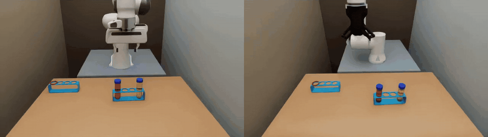
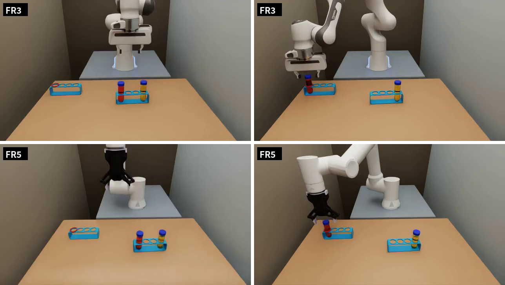
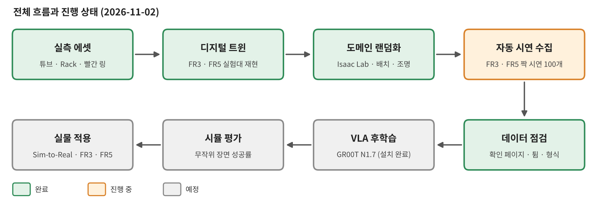
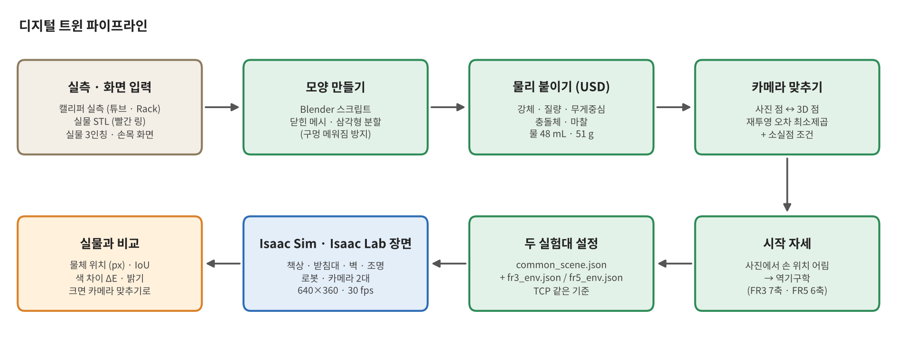
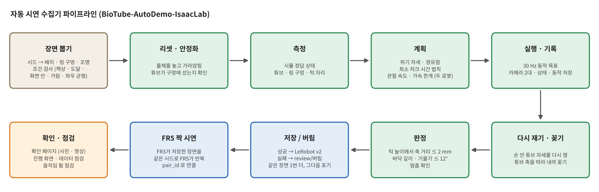
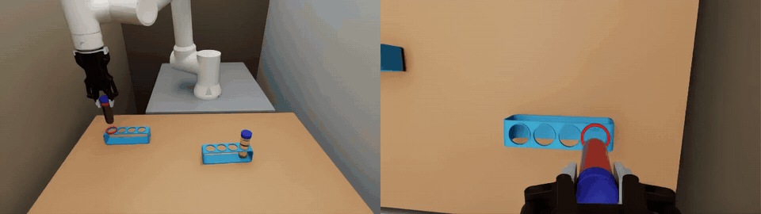

# Sim-to-Real Post-Training — Isaac Sim · Isaac Lab

**바이오 실험 튜브 정밀 삽입 과제의 시뮬레이션 파트** · Franka FR3 · FAIRINO FR5

[English](README_EN.md) · 자세한 구현과 코드: [BioTube-Insertion-VLA-IsaacLab](https://github.com/bbiyak12e/BioTube-Insertion-VLA-IsaacLab)



같은 장면(1103-27)을 두 로봇이 각자의 실험대 카메라로 수행한 짝 시연입니다. 1배속 영상: [demo_pair_scene27.mp4](reports/01_sim_env_autodemo/figures/demo_pair_scene27.mp4)

> **최근 소식**
> - 2026-11-06 · [보고서 2 — 시연 100개로 학습한 GR00T: 벤치마크 결과, 수집 설정 실수와 고칠 방향](reports/02_vla100_bench/README.md)
> - 2026-11-04 · GR00T N1.7 미세조정 (FR3 · FR5 시연 100개씩) · 처음 보는 50 장면 벤치마크
> - 2026-11-03 · FR3 · FR5 짝 시연 100개 수집 끝
> - 2026-11-02 · 자동 시연 수집기로 FR3 · FR5 짝 시연 100개 수집 시작
> - 2026-11-02 · GR00T N1.7 설치 완료
> - 2026-11-02 · [보고서 1 — 시뮬 환경 구축과 자동 시연 데이터 수집](reports/01_sim_env_autodemo/README.md)

---

## 1. 개요

- **프로젝트:** 원심분리 튜브를 Rack 구멍에 꽂는 바이오 실험 조작을 VLA(Vision-Language-Action) 모델로 자동화합니다. 실물 실험대는 FR3 · FR5 두 대입니다.
- **이 파트의 목표:** 실물 실험대를 재현한 시뮬에서 학습 데이터를 대량으로 만들고, 그 데이터로 VLA(GR00T N1.7)를 후학습해 실물로 옮깁니다.
- **이 파트가 맡는 것:** 디지털 트윈 → 도메인 랜덤화 → 자동 시연 데이터 → 시뮬 후학습 · 평가 → 실물 적용

## 2. 과제

| 항목 | 내용 |
|---|---|
| 지시문 | `put the red tube in the red slot` |
| 장면 | 원래 Rack (양 끝 구멍에 빨간 물 · 노란 물 튜브) + 빈 Rack (구멍 하나에 빨간 링) |
| 성공 | 빨간 튜브가 빨간 링 구멍에 꽂힘 — 튜브 축이 구멍 턱 높이에서 구멍 가운데로부터 2 mm 안을 지나고, 바닥까지 들어가고, 기울기 12° 안. 노란 튜브와 링은 제자리 |
| 어려운 점 | 튜브 지름 30 mm · 구멍 31 mm → **틈 1 mm**. 바닥이 둥근(반지름 15 mm) 튜브라 조금만 어긋나도 기울어 턱에 걸림 |
| 매 장면 바뀌는 것 | 두 Rack의 자리 · 방향, 빨강 · 노랑 좌우, 빨간 링 구멍(4개 중 하나), 조명 밝기 · 색 |



## 3. 시뮬 실험 구성 (실물 재현)

| 항목 | 시뮬 |
|---|---|
| 로봇 | Franka FR3 + Franka Hand, FAIRINO FR5 + DH-Robotics AG-95. 두 로봇의 손끝 기준점(TCP)을 같은 정의로 맞춤 |
| 카메라 | 3인칭 + 손목, 640×360, 30 fps. 실물 화면의 점을 재투영 오차 최소제곱으로 풀어 자리 · 각도를 맞춤 (3인칭 오차 2~4 px). 실물 데이터는 848×480 · 10 Hz — 맞추는 중 ([보고서 2](reports/02_vla100_bench/README.md) 4 · 5장) |
| 물체 | 실측으로 만든 50 mL 튜브(물 48 mL, 51 g) · 4구 Rack(165×40×51 mm) · 빨간 링(실물 STL) |
| 실험대 | FR3 · FR5 실험대마다 책상 · 받침대 · 벽 · 시작 자세를 따로 재현 |
| 소프트웨어 | Isaac Sim 6.0.1, Isaac Lab 3.0 (v3.0.0-beta2.patch1) |

## 4. 진행 상태 (갱신)



| 단계 | 상태 | 시기 |
|---|---|---|
| 실측 에셋 (튜브 · Rack · 링) | ✅ 완료 | 10-26 ~ 11-02 |
| 디지털 트윈 (FR3 · FR5 실험대) | ✅ 완료 | 10-27 ~ 10-29 |
| Isaac Lab 도메인 랜덤화 | ✅ 완료 | 10-28 ~ 10-31 |
| 자동 시연 수집기 | ✅ 완료 | 10-31 ~ 11-02 |
| FR3 · FR5 짝 시연 100개 | ✅ 완료 | 11-02 ~ 11-03 |
| GR00T N1.7 미세조정 (시연 100개) · 시뮬 벤치마크 | ✅ 완료 — [보고서 2](reports/02_vla100_bench/README.md) | 11-03 ~ 11-05 |
| GR00T N1.7 제로샷 (시뮬) | 🔄 2 장면 시험만 | 11-03 |
| 추가 수집 (A 200 짝 · B 300 짝) | 🔄 진행 중 (FR5 가 B 를 따라가는 중) | 11-03 ~ |
| 실물 형식 맞추기 (10 Hz · 848×480 · 상태 · 행동 정의 · 노출) · 돔 조명 고치기 | 🔄 진행 중 | 11-05 ~ |
| 형식 · 시연 수 · 배치를 바꾼 재학습 · 로봇별 비교 | 🔄 FR5 둘 학습 중 | 11-06 ~ |
| 실물 설정으로 다시 수집 (ab) | ⬜ 예정 | |
| 실물 적용 (Sim-to-Real) | ⬜ 예정 | |

## 5. 시뮬레이션 환경

### 5-1. 디지털 트윈



실측값과 실물 카메라 화면에서 출발해 물체 모델 · 카메라 · 시작 자세를 계산하고, 시뮬 화면을 다시 실물과 겹쳐 차이를 잽니다.
카메라는 사진에서 찍은 점 $`u_i`$ 와 같은 점의 3D 위치 $`X_i`$ 를 두고 재투영 오차를 최소로 하는 자세를 찾습니다.

```math
\min_{\,R,\;t}\;\sum_i \big\lVert\, u_i - \pi\!\left(K\,(R X_i + t)\right) \big\rVert^2
```

### 5-2. 도메인 랜덤화 (Isaac Lab)

장면마다 두 Rack의 자리 · 방향, 빨강 · 노랑 좌우, 빨간 링 구멍, 조명 밝기 · 색을 새로 뽑습니다.
뽑은 배치는 **책상 안 · 두 로봇의 도달 범위 안 · 두 로봇의 3인칭 화면 안 · 로봇이 가리지 않음** 조건을 모두 만족할 때만 쓰고, 계획 단계에서 두 로봇 모두 역기구학으로 다시 확인합니다.
좌우 조합과 링 구멍은 고르게 나오도록 묶음 단위로 섞고, 같은 시드면 FR3 · FR5가 같은 장면을 받습니다.

### 5-3. 자동 시연 수집기 (BioTube-AutoDemo-IsaacLab)



시뮬의 정답 상태로 튜브와 링 구멍의 자리를 재고, 경로를 계획해 실행 · 기록한 뒤, 판정해서 성공만 저장합니다.
구간마다 최소 저크 시간 법칙을 쓰고, 구간 시간 $`T`$ 는 두 로봇의 관절 속도 · 가속도 한계를 모두 지키도록 정합니다.

```math
s(\tau) = 10\tau^3 - 15\tau^4 + 6\tau^5,\qquad \tau = t/T \in [0,1]
```

꽂기는 손 안 튜브 자세를 다시 잰 뒤 **튜브 축을 따라** 내려가고, 성공은 구멍 턱 높이에서 튜브 축이 구멍 가운데로부터 얼마나 떨어졌는지로 판정합니다.
쓰인 수식과 적용 방법은 보고서 1의 [4장 디지털 트윈](reports/01_sim_env_autodemo/README.md#4-수식과-적용--디지털-트윈) · [5장 도메인 랜덤화](reports/01_sim_env_autodemo/README.md#5-수식과-적용--도메인-랜덤화) · [6장 자동 시연 생성과 판정](reports/01_sim_env_autodemo/README.md#6-수식과-적용--자동-시연-생성과-판정)에 모았습니다.



## 6. 데이터셋 (갱신)

| 항목 | 값 |
|---|---|
| 형식 | LeRobot v2 (GR00T 형식) |
| 영상 | 3인칭 · 손목, 640×360, 30 fps |
| 상태 · 동작 | 손끝 위치 3 + 자세 rot6d 6 + 그리퍼 1 + 관절 (FR3 7 · FR5 6) |
| 지시문 | `put the red tube in the red slot` |
| 짝 | 같은 장면(배치 · 조명)을 FR3 · FR5가 각각 수행, `pair_id` 로 연결 |

첫 100쌍 (11-02 ~ 03, 기본 시드 1103, 배치 A):

| | 저장 | 버림 · 포기 | 성공률 (시도마다) | 시연 길이 (시뮬) |
|---|---|---|---|---|
| FR3 | 100 | 버림 16 · 포기 2 | 86 % | 약 41 초 |
| FR5 | 100 | 버림 1 · 포기 0 | 99 % (쥔 동안 붙이기 보조) | 약 41 초 |
| 짝 (둘 다 저장) | 99 | — | — | — |

그 뒤 A 200 짝 · B 300 짝을 더 모았습니다 (B 는 FR5 가 따라가는 중). 실물과 다르게 모은 설정 (30 Hz · 640×360 · 상태 · 행동 정의 · 노출) 과 수집기 실행마다 돔 조명이 바뀐 문제는 변환기 · 다시 수집으로 고칩니다 — [보고서 2](reports/02_vla100_bench/README.md) 4 · 5장.

## 7. 모델과 실험 계획

- **모델:** [GR00T N1.7](https://github.com/NVIDIA/Isaac-GR00T) 기본 모델 (`nvidia/GR00T-N1.7-3B`, `NEW_EMBODIMENT`) — 로봇마다 따로 미세조정
- **입력 · 출력:** 카메라 2대 + 손끝 상태 + 그리퍼 → 손끝 상대 이동 + 그리퍼, 16 스텝 묶음 (지금 데이터 30 Hz → 0.53 초, 실물 형식 10 Hz → 1.6 초)
- **평가:** 학습에 쓰지 않은 같은 50 장면 (기본 시드 7700) · 학습 장면 10, 첫 시도만, 성공률에 95 % 범위. 비교하는 모델끼리 시도 수 · 조명 상태를 같게
- **순서:** ① 시연 100개 미세조정 · 벤치마크 (완료) → ② 형식 · 시연 수 · 배치를 하나씩 바꿔 재학습 (진행 중) → ③ 실물 설정 데이터 (ab) 로 로봇별 비교 → ④ 실물 적용

## 8. 결과 (갱신)

| | 학습 시연 | 처음 보는 50 장면 성공 | 95 % 범위 |
|---|---|---|---|
| FR3 | 100 | 2 / 50 (4 %) | 1.1 ~ 13.5 % |
| FR5 | 100 | 1 / 50 (2 %) | 0.4 ~ 10.5 % |

실물도 시연 100개 모델은 FR3 5 % · FR5 0 % 로 비슷합니다 (실물 200개 모델은 30 %). 낮은 까닭으로 색 대신 배치를 외움 · 쥐기 정밀도 · 짧은 행동 묶음을 의심하고,
FR3 벤치는 학습 데이터와 다른 조명 상태에서 재서 다시 잽니다. 자세히는 [보고서 2](reports/02_vla100_bench/README.md).

## 9. 보고서

| 번호 | 내용 | 날짜 | 링크 |
|---|---|---|---|
| 1 | 시뮬 환경 구축과 자동 시연 데이터 수집 | 2026-11-02 | [한국어](reports/01_sim_env_autodemo/README.md) · [English](reports/01_sim_env_autodemo/README_EN.md) |
| 2 | 시연 100개로 학습한 GR00T: 벤치마크 결과, 수집 설정 실수와 고칠 방향 | 2026-11-06 | [한국어](reports/02_vla100_bench/README.md) · [English](reports/02_vla100_bench/README_EN.md) |
| 3 | 실물 형식 재학습 · 시연 수 · 배치 비교 | 예정 | |
| 4 | Sim-to-Real | 예정 | |
