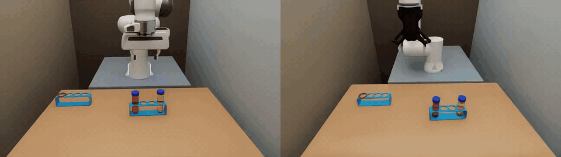
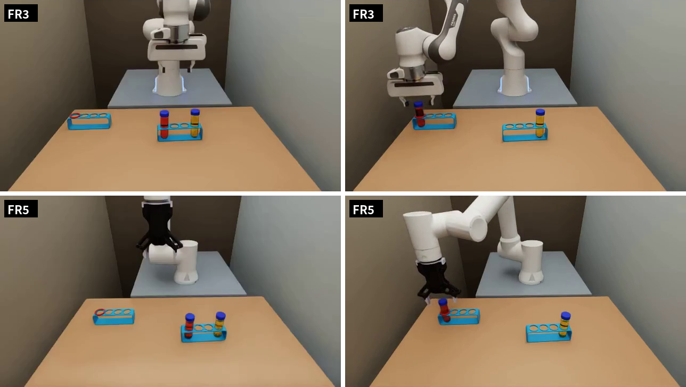
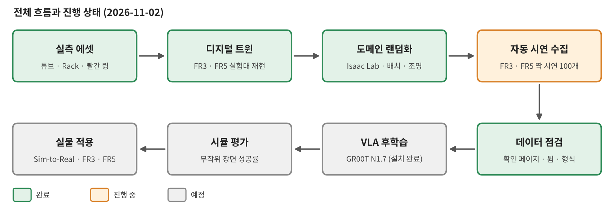
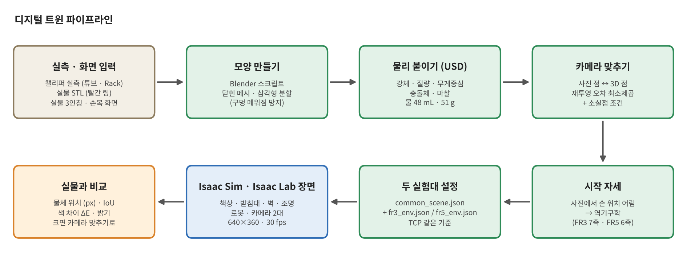
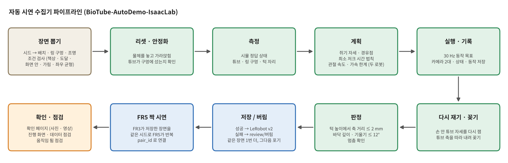
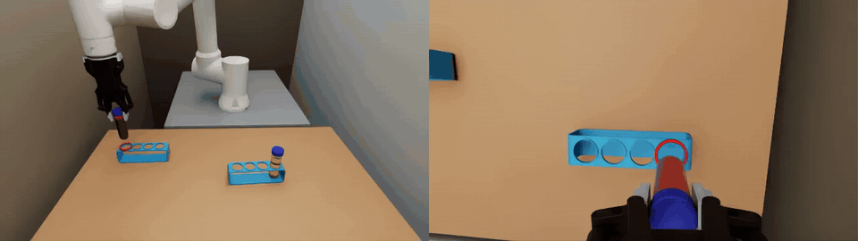
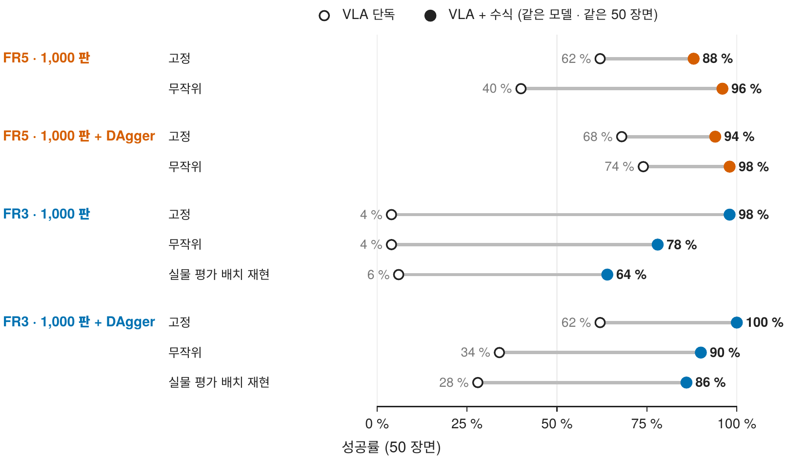

# Sim-to-Real Post-Training — Isaac Sim · Isaac Lab

**바이오 실험 튜브 정밀 삽입 과제의 시뮬레이션 파트** · Franka FR3 · FAIRINO FR5

[English](README_EN.md) · 자세한 구현과 코드: [BioTube-Insertion-VLA-IsaacLab](https://github.com/bbiyak12e/BioTube-Insertion-VLA-IsaacLab)



같은 장면(1103-27)을 두 로봇이 각자의 실험대 카메라로 수행한 짝 시연입니다. 1배속 영상: [demo_pair_scene27.mp4](reports/01_sim_env_autodemo/figures/demo_pair_scene27.mp4)

> **최근 소식**
> - 2026-11-20 · 진행 기록 (11-10 \~ 11-19): [보고서 5 — 본 벤치와 중단](reports/05_main_bench_stop/README.md) · [보고서 6 — 개선 실험](reports/06_improve_1112_1113/README.md) · [보고서 7 — sim-to-real 전환과 1,000 판 데이터](reports/07_sim2real_1000/README.md) · [보고서 8 — FR5 가까운 튜브 버릇 · DAgger · FR3 높게 닫음](reports/08_dagger_1114_1116/README.md) · [보고서 9 — FR5 영상 형식 · DAgger 다시 · 실물과 같은 수식 · 약점](reports/09_final_1116_1119/README.md)
> - 2026-11-16 · [보고서 4 — 시뮬 벤치 결과: FR3 · FR5 VLA 단독 · DAgger · 수식 마무리](reports/04_sim_bench/README.md) ([FR5](reports/04_sim_bench/fr5/README.md) · [FR3](reports/04_sim_bench/fr3/README.md))
> - 2026-11-10 · [보고서 3 — 실물 설정으로 다시 모은 짝 시연: 수학 모델의 확률 · 정확성, 실물 형식 변환, 실물 데이터와 비교](reports/03_realmatched_data/README.md)
> - 2026-11-06 · [보고서 2 — 시연 100개로 학습한 GR00T: 벤치마크 결과, 수집 설정 실수와 고칠 방향](reports/02_vla100_bench/README.md)
> - 2026-11-04 · GR00T N1.7 미세조정 (FR3 · FR5 시연 100개씩) · 처음 보는 50 장면 벤치마크
> - 2026-11-03 · FR3 · FR5 짝 시연 100개 수집 끝
> - 2026-11-02 · 자동 시연 수집기로 FR3 · FR5 짝 시연 100개 수집 시작
> - 2026-11-02 · GR00T N1.7 설치 완료
> - 2026-11-02 · [보고서 1 — 시뮬 환경 구축과 자동 시연 데이터 수집](reports/01_sim_env_autodemo/README.md)

---

## 1. 개요

- **프로젝트:** 원심분리 튜브를 Rack 구멍에 꽂는 바이오 실험 조작을 VLA(Vision-Language-Action) 모델로 자동화합니다. 실물 실험대는 FR3 · FR5 두 대입니다.
- **이 파트의 목표:** 실물 실험대를 재현한 시뮬에서 학습 데이터를 대량으로 만들고, 그 데이터로 VLA(GR00T N1.7)를 후학습해 실물로 옮깁니다.
- **이 파트가 맡는 것:** 디지털 트윈 → 도메인 랜덤화 → 자동 시연 데이터 → 시뮬 후학습 · 평가 → 실물 적용

## 2. 과제

| 항목 | 내용 |
|---|---|
| 지시문 | `put the red tube in the red slot` |
| 장면 | 원래 Rack (양 끝 구멍에 빨간 물 · 노란 물 튜브) + 빈 Rack (구멍 하나에 빨간 링) |
| 성공 | 빨간 튜브가 빨간 링 구멍에 꽂힘 — 튜브 축이 구멍 턱 높이에서 구멍 가운데로부터 2 mm 안을 지나고, 바닥까지 들어가고, 기울기 12° 안. 노란 튜브와 링은 제자리 |
| 어려운 점 | 튜브 지름 30 mm · 구멍 31 mm → **틈 1 mm**. 바닥이 둥근(반지름 15 mm) 튜브라 조금만 어긋나도 기울어 턱에 걸림 |
| 매 장면 바뀌는 것 | 두 Rack의 자리 · 방향, 빨강 · 노랑 좌우, 빨간 링 구멍(4개 중 하나), 조명 밝기 · 색 |



## 3. 시뮬 실험 구성 (실물 재현)

| 항목 | 시뮬 |
|---|---|
| 로봇 | Franka FR3 + Franka Hand (시뮬 모델은 Isaac 기본 Panda), FAIRINO FR5 + DH-Robotics AG-95. 두 로봇의 손끝 기준점(TCP)을 같은 정의로 맞춤 |
| 카메라 | 3인칭 + 손목, 848×480 · 10 Hz (실물 형식). **실물 맞춤 시뮬 (11-13 \~):** FR3 는 로봇 PC 의 카메라 보정값으로 다시 풀어 실물 모형과 평균 0.52 px, FR5 는 실물 팀이 맞춘 설정값 ([보고서 7](reports/07_sim2real_1000/README.md)) |
| 물체 | 실측으로 만든 50 mL 튜브(물 48 mL, 51 g) · 4구 Rack(165×40×51 mm) · 빨간 링(실물 STL) |
| 실험대 | FR3 · FR5 실험대마다 책상 · 받침대 · 벽을 따로 재현. 받침 높이 · 시작 자세 · 장면 색 · 카메라별 흰색 균형을 실물 값으로 (FR3 받침 23.5 mm 낮춤 → 잡는 높이가 실물과 0.3 mm) |
| 시뮬과 실물의 차이 | FR5 는 쥔 동안 튜브를 손에 붙이는 시뮬 보조가 있고 (실물에 없음), FR3 시뮬 팔은 실물 임피던스보다 단단함 — 시뮬 성공률은 실물 성공률을 대신하지 않음 ([보고서 8](reports/08_dagger_1114_1116/README.md) 6 절) |
| 소프트웨어 | Isaac Sim 6.0.1, Isaac Lab 3.0 (v3.0.0-beta2.patch1), GR00T N1.7 |

## 4. 진행 상태 (갱신)



그림은 11-06 기준입니다. 지금 상태는 아래 표와 같습니다 (2026-11-20).

| 단계 | 상태 | 시기 |
|---|---|---|
| 실측 에셋 (튜브 · Rack · 링) · 디지털 트윈 (FR3 · FR5 실험대) | ✅ 완료 | 10-26 \~ 11-02 |
| Isaac Lab 도메인 랜덤화 · 자동 시연 수집기 | ✅ 완료 | 10-28 \~ 11-02 |
| 짝 시연 100 개 · GR00T N1.7 미세조정 · 첫 벤치 | ✅ 완료 — [보고서 2](reports/02_vla100_bench/README.md) | 11-02 \~ 11-05 |
| 실물 형식 맞추기 (10 Hz · 848×480 · 상태 · 행동 정의 · 노출) · 실물 설정 짝 시연 | ✅ 완료 — [보고서 3](reports/03_realmatched_data/README.md) | 11-05 \~ 11-10 |
| 본 벤치 · 물리 튐 규칙 · 단계별 진단 · 학습량 (batch size 64) | ✅ 완료 — [보고서 5](reports/05_main_bench_stop/README.md) · [6](reports/06_improve_1112_1113/README.md) | 11-10 \~ 11-13 |
| 실물 맞춤 시뮬 (카메라 · 받침 높이 · 시작 자세 · 색) · 로봇마다 1,000 판 | ✅ 완료 — [보고서 7](reports/07_sim2real_1000/README.md) | 11-13 \~ 11-14 |
| VLA + 수식 · S0 \~ S9 단계 채점 · DAgger · FR5 영상 형식 통일 | ✅ 완료 — [보고서 4](reports/04_sim_bench/README.md) · [8](reports/08_dagger_1114_1116/README.md) · [9](reports/09_final_1116_1119/README.md) | 11-12 \~ 11-19 |
| 실물과 같은 수식 점검 · 실물 FR5 평가와 S0 \~ S9 비교 | 🔄 시험 기간 뒤 이어 감 | 11-19 \~ |
| 실물 적용 (Sim-to-Real) | ⬜ 예정 | |

## 5. 시뮬레이션 환경

### 5-1. 디지털 트윈



실측값과 실물 카메라 화면에서 출발해 물체 모델 · 카메라 · 시작 자세를 계산하고, 시뮬 화면을 다시 실물과 겹쳐 차이를 잽니다.
카메라는 사진에서 찍은 점 $`u_i`$ 와 같은 점의 3D 위치 $`X_i`$ 를 두고 재투영 오차를 최소로 하는 자세를 찾습니다.

```math
\min_{\,R,\;t}\;\sum_i \big\lVert\, u_i - \pi\!\left(K\,(R X_i + t)\right) \big\rVert^2
```

### 5-2. 도메인 랜덤화 (Isaac Lab)

장면마다 두 Rack의 자리 · 방향, 빨강 · 노랑 좌우, 빨간 링 구멍, 조명 밝기 · 색을 새로 뽑습니다.
뽑은 배치는 **책상 안 · 두 로봇의 도달 범위 안 · 두 로봇의 3인칭 화면 안 · 로봇이 가리지 않음** 조건을 모두 만족할 때만 쓰고, 계획 단계에서 두 로봇 모두 역기구학으로 다시 확인합니다.
좌우 조합과 링 구멍은 고르게 나오도록 묶음 단위로 섞고, 같은 시드면 FR3 · FR5가 같은 장면을 받습니다.

### 5-3. 자동 시연 수집기 (BioTube-AutoDemo-IsaacLab)



시뮬의 정답 상태로 튜브와 링 구멍의 자리를 재고, 경로를 계획해 실행 · 기록한 뒤, 판정해서 성공만 저장합니다.
구간마다 최소 저크 시간 법칙을 쓰고, 구간 시간 $`T`$ 는 두 로봇의 관절 속도 · 가속도 한계를 모두 지키도록 정합니다.

```math
s(\tau) = 10\tau^3 - 15\tau^4 + 6\tau^5,\qquad \tau = t/T \in [0,1]
```

꽂기는 손 안 튜브 자세를 다시 잰 뒤 **튜브 축을 따라** 내려가고, 성공은 구멍 턱 높이에서 튜브 축이 구멍 가운데로부터 얼마나 떨어졌는지로 판정합니다.
쓰인 수식과 적용 방법은 보고서 1의 [4장 디지털 트윈](reports/01_sim_env_autodemo/README.md#4-수식과-적용--디지털-트윈) · [5장 도메인 랜덤화](reports/01_sim_env_autodemo/README.md#5-수식과-적용--도메인-랜덤화) · [6장 자동 시연 생성과 판정](reports/01_sim_env_autodemo/README.md#6-수식과-적용--자동-시연-생성과-판정)에 모았습니다.



## 6. 데이터셋 (갱신)

| 항목 | 값 |
|---|---|
| 형식 | LeRobot v2.1 (GR00T 형식) — 로봇마다 실물 학습 데이터와 같은 형식으로 바꿈 (`tools/common_to_real.py`, [보고서 3](reports/03_realmatched_data/README.md)) |
| 영상 | 3인칭 · 손목, 848×480, 10 Hz, 판마다 첫 화면 밝기를 실물 목표로 (모델 입력은 비율을 지켜 452×256) |
| 상태 · 행동 | 로봇마다 실물 정의 — FR3 손끝 xyz + rot6d + 손가락 폭, FR5 손끝 xyz + rot6d + 그리퍼 반폭. 행동은 손끝 상대 이동 + 그리퍼 |
| 지시문 | `put the red tube in the red slot` |
| 지금 학습 데이터 (로봇마다) | 실물 맞춤 시뮬 1,000 판 + DAgger 구간 (FR5 597 · FR3 449, 각 300 판에서) |

로봇마다 1,000 판의 구성 (11-13 \~ 14, [보고서 7](reports/07_sim2real_1000/README.md)):

| 갈래 | 판 | 동작 | 학습에 넣는 구간 |
|---|---|---|---|
| ① 기본 | 150 | 실물 자동 수집기와 같은 동작을 실수 없이 | 전부 |
| ② 보정 | 300 | 어림 자리 위에서 멈춤 → 옆으로 1 \~ 8 mm 고침 → 내려감 | 전부 |
| ③ 빗나감 + 바로잡기 | 250 | 10 \~ 40 mm 빗나간 자리 위에서 멈춤 → 내려가며 바로잡음 | 빗나간 자리부터 |
| ④ 실패에서 다시 하기 | 150 | 헛잡음 → 다시 쥠, 꽂다 걸림 → 다시 꽂음 | 실패한 상태부터 |
| ⑤ 실물 빈틈 | 150 | ② · ③ 동작을 실물 데이터에 없던 먼 쪽 · 넓게 흔든 배치에서 | ② · ③ 과 같음 |

처음 짝 시연 (11-02 \~ 05, 640×360 · 30 Hz) 은 [보고서 1](reports/01_sim_env_autodemo/README.md) · [2](reports/02_vla100_bench/README.md), 실물 설정으로 다시 모은 짝 시연은 [보고서 3](reports/03_realmatched_data/README.md) 에 있습니다.

## 7. 모델 · 학습 · 평가

- **모델:** [GR00T N1.7](https://github.com/NVIDIA/Isaac-GR00T) 기본 모델 (`nvidia/GR00T-N1.7-3B`, `NEW_EMBODIMENT`) — 로봇마다 따로 미세조정 (시각 · 언어 백본은 얼리고 행동 부분을 학습)
- **입력 · 출력:** 카메라 2 대 + 손끝 상태 + 그리퍼 → 손끝 상대 이동 + 그리퍼, action chunk 16 칸 (10 Hz → 1.6 초)
- **학습:** batch size 64 × 20,000 번 고침 (표본 128 만, FR3 는 32 개씩 두 번 모아 한 번 고침), 색 흔들기 켬 — 두 로봇이 같은 학습 설정 파일
- **평가:** 학습에 쓰지 않은 같은 50 장면 — 고정 배치 · 무작위 배치 (FR3 는 실물 평가 배치 재현도), 장면마다 첫 판, 물리 튐 = 실패, 실물과 같은 S0 \~ S9 단계 채점. 판정 기준은 결과를 보기 전에 정함
- **두 가지 실행을 따로 보고:** 정책만 · VLA + 수식 (정책이 목표를 고르고, 마지막 잡기 · 꽂기만 자동 시연 수식이 넘겨받음)
- **DAgger:** 정책을 학습에 없던 300 장면에서 돌려, 정책이 빗나간 자리에서 수식이 바로잡은 구간만 데이터에 더해 처음부터 다시 학습
- **다음 (시험 기간 뒤):** 실물과 같은 조건의 수식 (카메라로 찾음) 점검 → 실물 FR5 평가와 S0 \~ S9 비교 → 다음 실험 하나 (DAgger 2 회차 · FR5 그리퍼 모델 단순화 · 노란 링 과제 · 강화학습 미세조정 · GR00T N2 가운데)

## 8. 결과 (갱신)

실물 맞춤 시뮬 · 학습에 쓰지 않은 같은 50 장면 · 장면마다 첫 판 (물리 튐 = 실패) 의 성공률입니다 (2026-11-19, [보고서 9](reports/09_final_1116_1119/README.md)).

| 로봇 · 모델 | 정책만 · 고정 | 정책만 · 무작위 | VLA + 수식 · 고정 | VLA + 수식 · 무작위 |
|---|---|---|---|---|
| FR5 · 1,000 판 | 62 % | 40 % | 88 % | 96 % |
| FR5 · 1,000 판 + DAgger | 68 % | 74 % | 94 % | 98 % |
| FR3 · 1,000 판 | 4 % | 4 % | 98 % | 78 % |
| FR3 · 1,000 판 + DAgger | 62 % | 34 % | 100 % | 90 % |



- **정책만:** GR00T N1.7 이 혼자 집고 꽂은 결과. FR5 는 학습 영상을 FR3 와 같은 방식 (848×480 → 비율을 지켜 452×256) 으로 바꾸자 고정 배치 16 → 62 % 가 되었고, 두 로봇 모두 **DAgger** (정책이 실제로 틀린 자리에서 수식이 바로잡은 구간만 더해 다시 학습) 로 크게 올랐습니다 — FR5 의 「가까운 튜브로 가는 버릇」, FR3 의 「약 6 mm 높게 닫음」 을 고침.
- **VLA + 수식:** 정책이 튜브 · 칸을 고르고, 정책이 뚜껑 · 빨간 칸 25 mm 안으로 오면 마지막 잡기 · 꽂기만 자동 시연 수식이 넘겨받는 실행 (실물 FR3 스테이션과 같은 구조). 수식은 정책이 고른 튜브를 바꾸지 않습니다.
- FR3 의 실물 평가 배치 재현 (10 배치 × 조명 5) 은 1,000 판 6 % → DAgger 28 % (VLA + 수식 64 → 86 %).

**읽을 때 주의.** 시뮬 성공률은 실물 성공률의 예측이 아니라, 같은 시뮬 · 같은 물리에서 모델끼리 견주는 도구입니다. FR5 시뮬은 실물에 없는 쥐기 보조 (쥔 동안 붙이기) 에 기대고, FR3 시뮬 (Isaac 기본 Panda 모델) 에는 그 보조가 없습니다. 고정 배치는 사실상 배치 둘 × 25 장면이라, 처음 보는 자리에서의 성능은 무작위 배치로 읽습니다. 자세한 분석은 [보고서 4](reports/04_sim_bench/README.md) · 진행 기록 [5](reports/05_main_bench_stop/README.md) ~ [9](reports/09_final_1116_1119/README.md).

## 9. 보고서

| 번호 | 내용 | 날짜 | 링크 |
|---|---|---|---|
| 1 | 시뮬 환경 구축과 자동 시연 데이터 수집 | 2026-11-02 | [한국어](reports/01_sim_env_autodemo/README.md) · [English](reports/01_sim_env_autodemo/README_EN.md) |
| 2 | 시연 100개로 학습한 GR00T: 벤치마크 결과, 수집 설정 실수와 고칠 방향 | 2026-11-06 | [한국어](reports/02_vla100_bench/README.md) · [English](reports/02_vla100_bench/README_EN.md) |
| 3 | 실물 설정으로 다시 모은 짝 시연: 수학 모델의 확률 · 정확성, 실물 형식 변환, 실물 데이터와 비교 | 2026-11-10 | [한국어](reports/03_realmatched_data/README.md) · [English](reports/03_realmatched_data/README_EN.md) |
| 4 | 시뮬 벤치 결과 — FR3 · FR5 VLA 단독 · DAgger · 수식 마무리 | 2026-11-16 | [통합](reports/04_sim_bench/README.md) · [FR5](reports/04_sim_bench/fr5/README.md) · [FR3](reports/04_sim_bench/fr3/README.md) · [English](reports/04_sim_bench/README_EN.md) |
| 5 | 진행 기록 — 본 벤치와 중단: 물리 튐 · 단계별 진단 · 학습량 | 2026-11-10 \~ 12 | [한국어](reports/05_main_bench_stop/README.md) · [English](reports/05_main_bench_stop/README_EN.md) |
| 6 | 진행 기록 — 개선 실험: VLA + 수식 벤치 · 빗나감 바로잡기 시연 | 2026-11-12 \~ 13 | [한국어](reports/06_improve_1112_1113/README.md) · [English](reports/06_improve_1112_1113/README_EN.md) |
| 7 | 진행 기록 — sim-to-real 전환과 1,000 판 데이터 | 2026-11-13 \~ 14 | [한국어](reports/07_sim2real_1000/README.md) · [English](reports/07_sim2real_1000/README_EN.md) |
| 8 | 진행 기록 — FR5 가까운 튜브 버릇 · DAgger · FR3 높게 닫음 | 2026-11-14 \~ 16 | [한국어](reports/08_dagger_1114_1116/README.md) · [English](reports/08_dagger_1114_1116/README_EN.md) |
| 9 | 진행 기록 — FR5 영상 형식 · DAgger 다시 · 실물과 같은 수식 · 약점 | 2026-11-16 \~ 19 | [한국어](reports/09_final_1116_1119/README.md) · [English](reports/09_final_1116_1119/README_EN.md) |
| 10 | Sim-to-Real | 예정 | |
