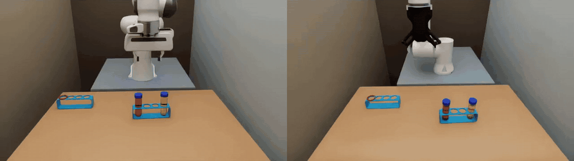
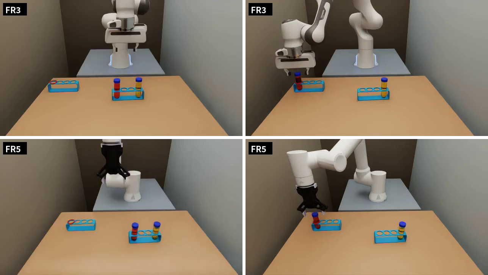
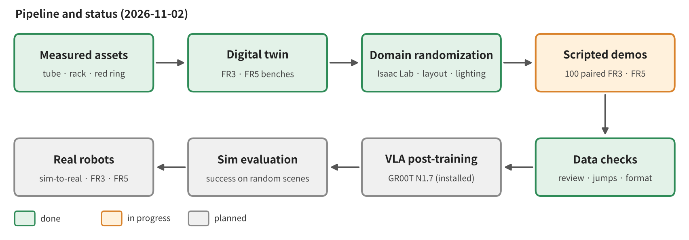
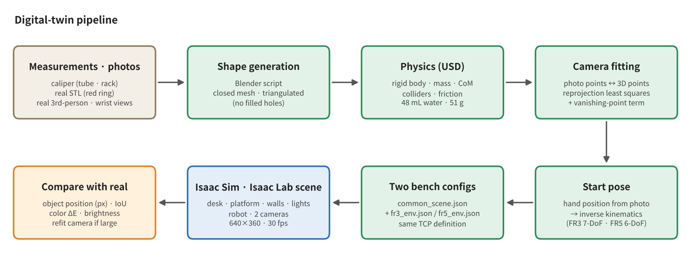
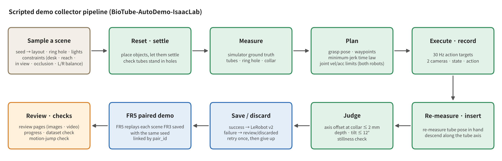
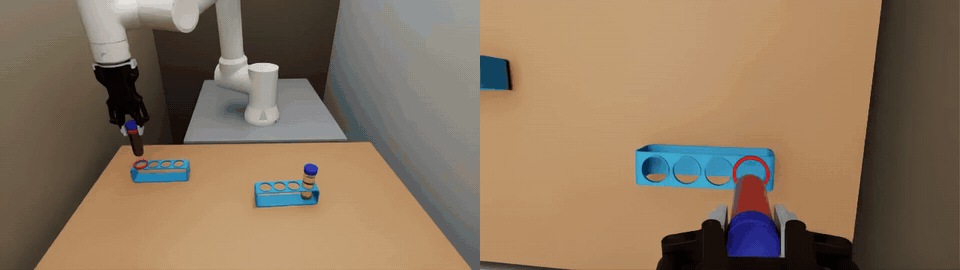

# Sim-to-Real Post-Training — Isaac Sim · Isaac Lab

**Simulation part of the precision bio-lab tube insertion task** · Franka FR3 · FAIRINO FR5

[한국어](README.md) · Detailed implementation and code: [BioTube-Insertion-VLA-IsaacLab](https://github.com/bbiyak12e/BioTube-Insertion-VLA-IsaacLab)



Paired demonstrations of the same scene (1103-27), each performed by one robot with its own workcell cameras. 1× video: [demo_pair_scene27.mp4](reports/01_sim_env_autodemo/figures/demo_pair_scene27.mp4)

> **Latest news**
> - 2026-11-06 · [Report 2 — GR00T trained on 100 demos: benchmark results, data-collection mistakes, and how we will fix them](reports/02_vla100_bench/README_EN.md)
> - 2026-11-04 · Fine-tuned GR00T N1.7 (100 demos each for FR3 · FR5) · benchmark on 50 unseen scenes
> - 2026-11-03 · Finished collecting 100 FR3 · FR5 paired demonstrations
> - 2026-11-02 · Started collecting 100 FR3 · FR5 paired demonstrations with the scripted demo collector
> - 2026-11-02 · GR00T N1.7 installed
> - 2026-11-02 · [Report 1 — Building the sim environment and collecting scripted demonstration data](reports/01_sim_env_autodemo/README_EN.md)

---

## 1. Overview

- **Project:** Automate a bio-lab manipulation — inserting a centrifuge tube into a rack hole — with a VLA (Vision-Language-Action) model. There are two real workcells: FR3 and FR5.
- **Goal of this part:** Generate training data at scale in a simulation that reproduces the real workcells, post-train a VLA (GR00T N1.7) on that data, and transfer it to the real robots.
- **What this part covers:** digital twin → domain randomization → scripted demonstration data → sim post-training · evaluation → real-world deployment

## 2. Task

| Item | Description |
|---|---|
| Instruction | `put the red tube in the red slot` |
| Scene | Source rack (red-water and yellow-water tubes in the two end holes) + empty rack (red ring on one hole) |
| Success | The red tube is inserted into the red-ring hole (red slot) — at the hole-collar height the tube axis passes within 2 mm of the hole center, the tube reaches the bottom, and the tilt is within 12°. The yellow tube and the ring stay in place |
| Difficulty | Tube diameter 30 mm · hole 31 mm → **1 mm clearance**. The tube has a round bottom (radius 15 mm), so even a slight misalignment tilts it and it catches on the collar |
| Randomized per scene | Position · orientation of both racks, red/yellow left-right order, red-ring hole (one of 4), lighting brightness · color |



## 3. Sim experiment setup (replicating the real setup)

| Item | Sim |
|---|---|
| Robots | Franka FR3 + Franka Hand, FAIRINO FR5 + DH-Robotics AG-95. The TCPs of both robots use the same definition |
| Cameras | Third-person + wrist, 640×360, 30 fps. Position · angle fitted by least-squares minimization of the reprojection error of points in the real camera images (third-person error 2–4 px). The real data is 848×480 · 10 Hz — being matched ([Report 2](reports/02_vla100_bench/README_EN.md), Sections 4 · 5) |
| Objects | 50 mL tube built from measurements (48 mL water, 51 g) · 4-hole rack (165×40×51 mm) · red ring (STL of the real part) |
| Workcells | Table · pedestal · wall · start pose reproduced separately for each of the FR3 and FR5 workcells |
| Software | Isaac Sim 6.0.1, Isaac Lab 3.0 (v3.0.0-beta2.patch1) |

## 4. Progress (updated)



| Stage | Status | Period |
|---|---|---|
| Measured assets (tube · rack · ring) | ✅ Done | Oct 26 – Nov 2 |
| Digital twin (FR3 · FR5 workcells) | ✅ Done | Oct 27 – Oct 29 |
| Isaac Lab domain randomization | ✅ Done | Oct 28 – Oct 31 |
| Scripted demo collector | ✅ Done | Oct 31 – Nov 2 |
| 100 FR3 · FR5 paired demonstrations | ✅ Done | Nov 2 – Nov 3 |
| GR00T N1.7 fine-tuning (100 demos) · sim benchmark | ✅ Done — [Report 2](reports/02_vla100_bench/README_EN.md) | Nov 3 – Nov 5 |
| GR00T N1.7 zero-shot (sim) | 🔄 2-scene trial only | Nov 3 |
| More collection (200 A pairs · 300 B pairs) | 🔄 In progress (FR5 following B) | Nov 3 – |
| Matching the real format (10 Hz · 848×480 · state · action definitions · exposure) · fixing the dome light | 🔄 In progress | Nov 5 – |
| Retraining with format · number of demos · layout changed · per-robot comparison | 🔄 Two FR5 runs training | Nov 6 – |
| Re-collection with the real settings (ab) | ⬜ Planned | |
| Real-world deployment (Sim-to-Real) | ⬜ Planned | |

## 5. Simulation environment

### 5-1. Digital twin



Starting from real measurements and the real camera images, we compute the object models, cameras, and start poses, then overlay the sim images on the real ones again to measure the difference.
For each camera, given points $`u_i`$ picked in the photo and the 3D positions $`X_i`$ of the same points, we find the pose that minimizes the reprojection error.

```math
\min_{\,R,\;t}\;\sum_i \big\lVert\, u_i - \pi\!\left(K\,(R X_i + t)\right) \big\rVert^2
```

### 5-2. Domain randomization (Isaac Lab)

For each scene we resample the position · orientation of both racks, the red/yellow left-right order, the red-ring hole, and the lighting brightness · color.
A sampled layout is used only if it satisfies all of the following conditions: **on the table · within reach of both robots · inside both robots' third-person views · not occluded by the robots**; at the planning stage, it is re-checked with inverse kinematics for both robots.
Left-right combinations and ring holes are shuffled in blocks so that they appear evenly, and with the same seed FR3 and FR5 receive the same scene.

### 5-3. Scripted demo collector (BioTube-AutoDemo-IsaacLab)



Using the sim ground-truth state, the collector measures the positions of the tube and the red-ring hole, plans a path, executes and records it, then checks the result and saves only successes.
Each segment uses a minimum-jerk time law, and the segment duration $`T`$ is chosen so that the joint velocity and acceleration limits of both robots are respected.

```math
s(\tau) = 10\tau^3 - 15\tau^4 + 6\tau^5,\qquad \tau = t/T \in [0,1]
```

For insertion, the in-hand tube pose is re-measured and the tube descends **along the tube axis**; success is judged by how far the tube axis is from the hole center at the hole-collar height.
The equations used and how they are applied are collected in Report 1, [Section 4, digital twin](reports/01_sim_env_autodemo/README_EN.md#4-equations-and-application--digital-twin) · [Section 5, domain randomization](reports/01_sim_env_autodemo/README_EN.md#5-equations-and-application--domain-randomization) · [Section 6, scripted demo generation and success check](reports/01_sim_env_autodemo/README_EN.md#6-equations-and-application--scripted-demo-generation-and-success-check).



## 6. Dataset (updated)

| Item | Value |
|---|---|
| Format | LeRobot v2 (GR00T format) |
| Video | Third-person · wrist, 640×360, 30 fps |
| State · action | TCP position 3 + orientation rot6d 6 + gripper 1 + joints (FR3 7 · FR5 6) |
| Instruction | `put the red tube in the red slot` |
| Pairing | The same scene (layout · lighting) is performed by FR3 and FR5 separately and linked by `pair_id` |

First 100 pairs (Nov 2 – 3, base seed 1103, layout A):

| | Saved | Discarded · given up | Success rate (per attempt) | Demo length (sim) |
|---|---|---|---|---|
| FR3 | 100 | 16 discarded · 2 given up | 86 % | about 41 s |
| FR5 | 100 | 1 discarded · 0 given up | 99 % (in-hand hold assist) | about 41 s |
| Pair (both saved) | 99 | — | — | — |

Since then we collected 200 more A pairs · 300 B pairs (FR5 still following B). The settings that differ from the real robots (30 Hz · 640×360 · state · action definitions · exposure) and the dome light that changed with each collector run are being fixed by conversion and re-collection — [Report 2](reports/02_vla100_bench/README_EN.md), Sections 4 · 5.

## 7. Model and experiment plan

- **Model:** [GR00T N1.7](https://github.com/NVIDIA/Isaac-GR00T) base model (`nvidia/GR00T-N1.7-3B`, `NEW_EMBODIMENT`) — fine-tuned per robot
- **Input · output:** 2 cameras + TCP state + gripper → relative TCP motion + gripper, in chunks of 16 steps (current data 30 Hz → 0.53 s, real format 10 Hz → 1.6 s)
- **Evaluation:** the same 50 scenes not used for training (base seed 7700) · 10 training scenes, first attempt only, 95 % CI with every success rate. Same number of trials and the same lighting state for every model compared
- **Order:** ① fine-tuning on 100 demos · benchmark (done) → ② retraining with format · number of demos · layout changed one at a time (in progress) → ③ per-robot comparison on data with the real settings (ab) → ④ real-world deployment

## 8. Results (updated)

| | Training demos | Success on 50 unseen scenes | 95 % CI |
|---|---|---|---|
| FR3 | 100 | 2 / 50 (4 %) | 1.1–13.5 % |
| FR5 | 100 | 1 / 50 (2 %) | 0.4–10.5 % |

Real-robot models trained on 100 demos are similar (FR3 5 % · FR5 0 %; the real 200-demo model reaches 30 %). We suspect layout memorization instead of color, grasp precision, and a short action chunk.
The FR3 benchmark was run under a lighting state different from its training data and will be re-measured. Details in [Report 2](reports/02_vla100_bench/README_EN.md).

## 9. Reports

| No. | Content | Date | Link |
|---|---|---|---|
| 1 | Building the sim environment and collecting scripted demonstration data | 2026-11-02 | [한국어](reports/01_sim_env_autodemo/README.md) · [English](reports/01_sim_env_autodemo/README_EN.md) |
| 2 | GR00T trained on 100 demos: benchmark results, data-collection mistakes, and how we will fix them | 2026-11-06 | [한국어](reports/02_vla100_bench/README.md) · [English](reports/02_vla100_bench/README_EN.md) |
| 3 | Real-format retraining · number of demos · layout comparison | Planned | |
| 4 | Sim-to-Real | Planned | |
