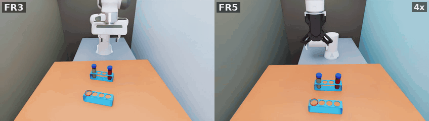
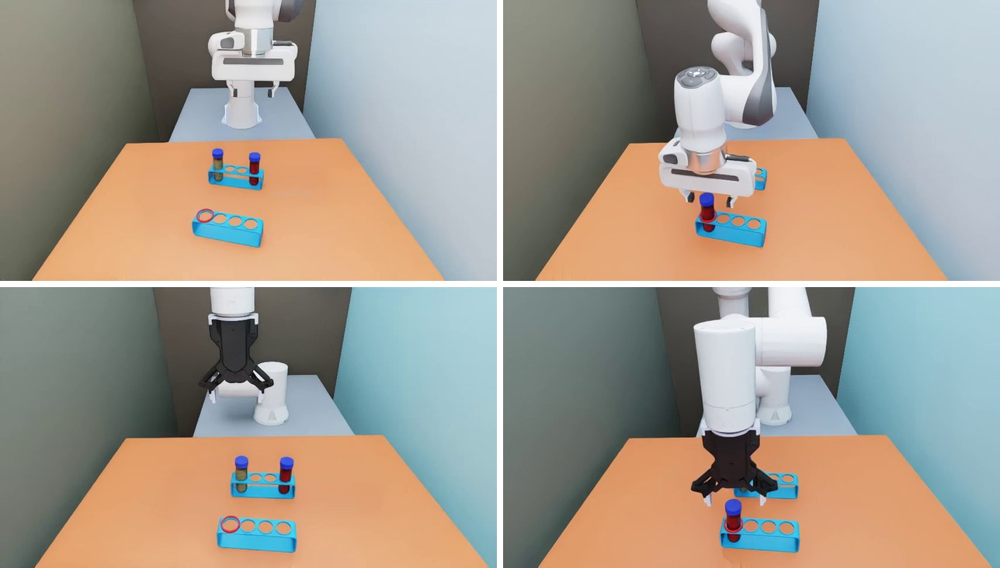
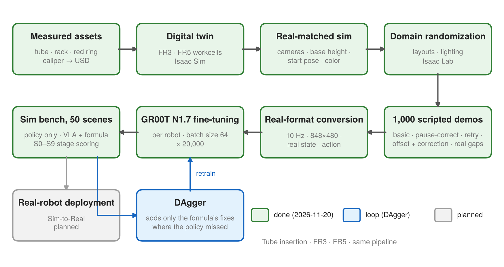
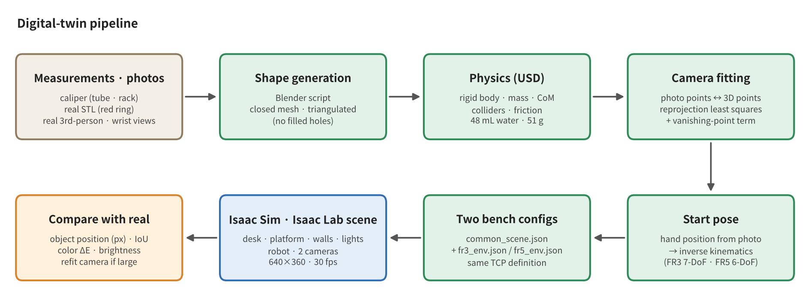
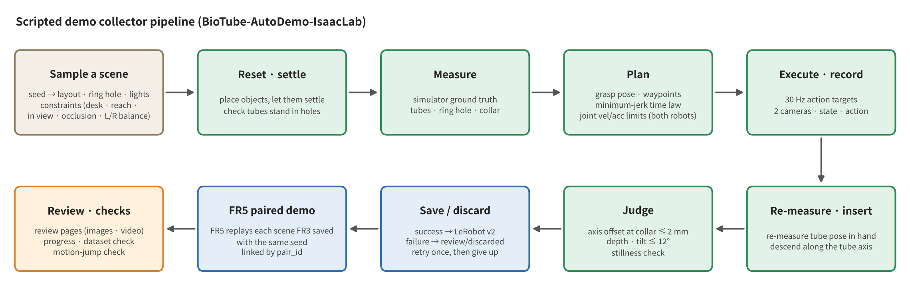
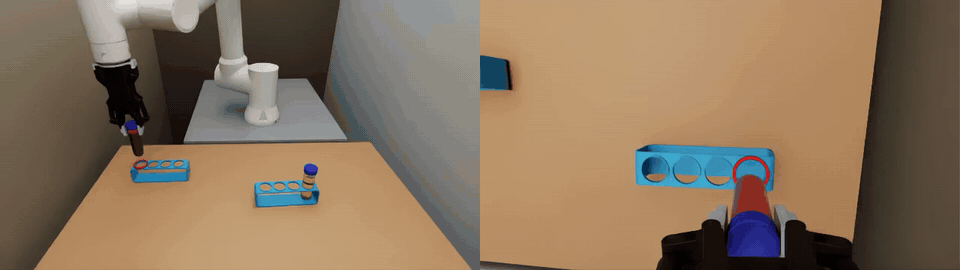
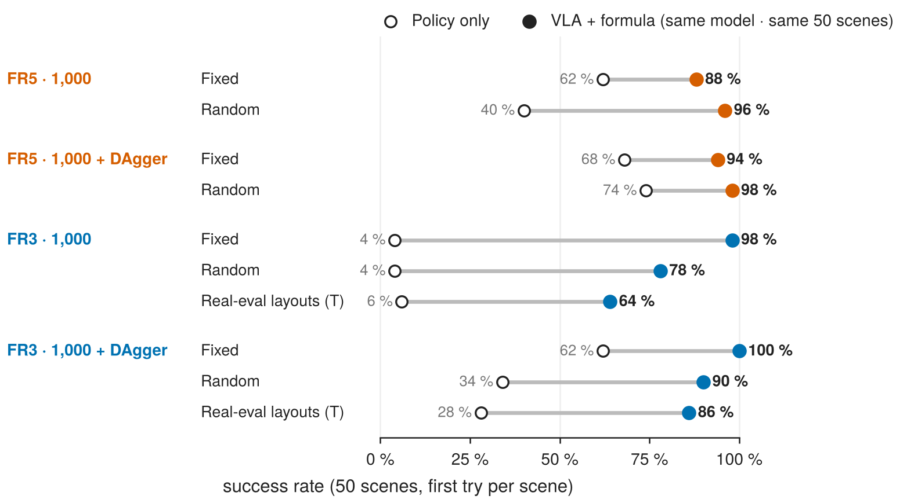
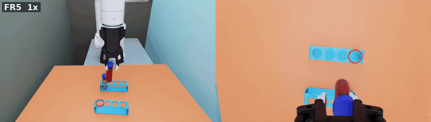

# Tube insertion — Sim-to-Real Post-Training (Isaac Sim · Isaac Lab)

**Precision bio-lab tube insertion · simulation part** · Franka FR3 · FAIRINO FR5

[한국어](README.md) · [← Sim experiments (tube · dropper · beaker)](../README.md) · Detailed implementation and code: [BioTube-Insertion-VLA-IsaacLab](https://github.com/bbiyak12e/BioTube-Insertion-VLA-IsaacLab)



**GR00T N1.7 retrained with DAgger picks and inserts on its own (policy only)** — one bench scene not used in training (random layout, scene 1; both robots get the same layout and lighting), FR3 on the left · FR5 on the right, third-person camera, 4× speed. The models before DAgger failed this scene on both robots. 1× video (third-person · wrist): [demo_pair_dagger_1x.mp4](figures/demo_pair_dagger_1x.mp4)

> **Latest news**
> - 2026-11-20 · Renamed this folder from `sim_isaac` to `sim_isaac_tube`. The [dropper](../sim_isaac_dropper/README_EN.md) and [beaker pouring](../sim_isaac_beaker/README_EN.md) experiments, which use the same real-matched workcells, live in the folders next to it.
> - 2026-11-20 · Progress-log reports [5](reports/05_main_bench_stop/README_EN.md) · [6](reports/06_improve_1112_1113/README_EN.md) · [7](reports/07_sim2real_1000/README_EN.md) · [8](reports/08_dagger_1114_1116/README_EN.md) · [9](reports/09_final_1116_1119/README_EN.md) (Nov 10 – Nov 19) — final numbers in [Section 8, Results](#8-results)
> - 2026-11-16 · [Report 4 — Sim benchmark results: VLA only · DAgger · VLA + formula](reports/04_sim_bench/README_EN.md)

<details>
<summary>Earlier news (Nov 2 – Nov 10)</summary>

- 2026-11-10 · [Report 3 — Paired demos re-collected with real-matched settings](reports/03_realmatched_data/README_EN.md)
- 2026-11-06 · [Report 2 — GR00T trained on 100 demos](reports/02_vla100_bench/README_EN.md)
- 2026-11-04 · Fine-tuned GR00T N1.7 (100 demos each for FR3 · FR5) · benchmark on 50 unseen scenes
- 2026-11-03 · Finished collecting 100 FR3 · FR5 paired demonstrations
- 2026-11-02 · [Report 1 — Building the sim environment and collecting scripted demonstration data](reports/01_sim_env_autodemo/README_EN.md) · GR00T N1.7 installed · paired-demo collection started

</details>

---

## 1. Overview

- **Project:** Automate a bio-lab manipulation — inserting a centrifuge tube into a rack hole — with a VLA (Vision-Language-Action) model. There are two real workcells: FR3 and FR5.
- **Goal of this part:** Generate training data at scale in a simulation that reproduces the real workcells, post-train a VLA (GR00T N1.7) on that data, and transfer it to the real robots.
- **Pipeline:** digital twin → real-matched sim · domain randomization → scripted demonstration data → sim post-training · benchmark · DAgger → real-robot deployment (planned)

## 2. Task

| Item | Description |
|---|---|
| Instruction | `put the red tube in the red slot` |
| Scene | Source rack (red-water and yellow-water tubes in the two end holes) + empty rack (red ring on one hole) |
| Success | The red tube is inserted into the red-ring hole (red slot) — at the hole-collar height the tube axis passes within 2 mm of the hole center, the tube reaches the bottom, and the tilt is within 12°. The yellow tube and the ring stay in place |
| Difficulty | Tube diameter 30 mm · hole 31 mm → **1 mm clearance**. The tube has a round bottom (radius 15 mm), so even a slight misalignment tilts it and it catches on the collar |
| Randomized per scene | Position · orientation of both racks, red/yellow left-right order, red-ring hole (one of 4), lighting brightness · color |



The same scene in the real-matched sim (from Nov 13) — start on the left, insertion on the right, FR3 on top · FR5 below.

## 3. Sim experiment setup (replicating the real setup)

| Item | Sim |
|---|---|
| Robots | Franka FR3 + Franka Hand (the sim model is Isaac's default Panda), FAIRINO FR5 + DH-Robotics AG-95. The TCPs of both robots use the same definition |
| Cameras | Third-person + wrist, 848×480 · 10 Hz (real format). FR3 re-solved from the robot PC's camera calibration — 0.52 px mean against the real model; FR5 uses the settings matched by the real team ([Report 7](reports/07_sim2real_1000/README_EN.md)) |
| Objects | 50 mL tube built from measurements (48 mL water, 51 g) · 4-hole rack (165×40×51 mm) · red ring (STL of the real part) |
| Workcells | Table · pedestal · wall reproduced separately for the FR3 and FR5 workcells. Base height · start pose · scene color · per-camera white balance set to the real values (FR3 base lowered 23.5 mm → grasp height within 0.3 mm of the real one) |
| Sim vs. real | FR5 has a sim assist that attaches the tube to the hand while held (not on the real robot), and the sim FR3 arm is stiffer than the real impedance control — sim success does not stand in for real success ([Report 8](reports/08_dagger_1114_1116/README_EN.md), Section 6) |
| Software | Isaac Sim 6.0.1, Isaac Lab 3.0 (v3.0.0-beta2.patch1), GR00T N1.7 |

## 4. Progress



Green stages are done, blue is the DAgger loop, gray is planned (2026-11-20).

| Stage | Status | Period |
|---|---|---|
| Measured assets (tube · rack · ring) · digital twin (FR3 · FR5 workcells) | ✅ Done | Oct 26 – Nov 2 |
| Isaac Lab domain randomization · scripted demo collector | ✅ Done | Oct 28 – Nov 2 |
| 100 paired demos · GR00T N1.7 fine-tuning · first benchmark | ✅ Done — [Report 2](reports/02_vla100_bench/README_EN.md) | Nov 2 – Nov 5 |
| Matching the real format (10 Hz · 848×480 · state · action definitions · exposure) · paired demos with the real settings | ✅ Done — [Report 3](reports/03_realmatched_data/README_EN.md) | Nov 5 – Nov 10 |
| Main bench · physics-jump rule · stage diagnosis · training amount (batch size 64) | ✅ Done — [Report 5](reports/05_main_bench_stop/README_EN.md) · [6](reports/06_improve_1112_1113/README_EN.md) | Nov 10 – Nov 13 |
| Real-matched sim (cameras · base height · start pose · color) · 1,000 demos per robot | ✅ Done — [Report 7](reports/07_sim2real_1000/README_EN.md) | Nov 13 – Nov 14 |
| VLA + formula · S0–S9 stage scoring · DAgger · FR5 video format unified | ✅ Done — [Report 4](reports/04_sim_bench/README_EN.md) · [8](reports/08_dagger_1114_1116/README_EN.md) · [9](reports/09_final_1116_1119/README_EN.md) | Nov 12 – Nov 19 |
| Formula under real-robot conditions (finds targets with the camera) — first check on Nov 19 ([Report 9](reports/09_final_1116_1119/README_EN.md), Section 5); check again · side bench | ⬜ Planned | |
| S0–S9 comparison with the real FR5 evaluation | ⬜ Planned | |
| Real-robot deployment (Sim-to-Real) | ⬜ Planned | |

## 5. Simulation environment

### 5-1. Digital twin



Starting from real measurements and the real camera images, we compute the object models, cameras, and start poses, then overlay the sim images on the real ones again to measure the difference.
For each camera, given points $`u_i`$ picked in the photo and the 3D positions $`X_i`$ of the same points, we find the pose that minimizes the reprojection error.

```math
\min_{\,R,\;t}\;\sum_i \big\lVert\, u_i - \pi\!\left(K\,(R X_i + t)\right) \big\rVert^2
```

### 5-2. Domain randomization (Isaac Lab)

For each scene we resample the position · orientation of both racks, the red/yellow left-right order, the red-ring hole, and the lighting brightness · color.
A sampled layout is used only if it satisfies all of the following conditions: **on the table · within reach of both robots · inside both robots' third-person views · not occluded by the robots**; at the planning stage, it is re-checked with inverse kinematics for both robots.
Left-right combinations and ring holes are shuffled in blocks so that they appear evenly, and with the same seed FR3 and FR5 receive the same scene.

### 5-3. Scripted demo collector (BioTube-AutoDemo-IsaacLab)



Using the sim ground-truth state, the collector measures the positions of the tube and the red-ring hole, plans a path, executes and records it, then checks the result and saves only successes.
Each segment uses a minimum-jerk time law, and the segment duration $`T`$ is chosen so that the joint velocity and acceleration limits of both robots are respected.

```math
s(\tau) = 10\tau^3 - 15\tau^4 + 6\tau^5,\qquad \tau = t/T \in [0,1]
```

For insertion, the in-hand tube pose is re-measured and the tube descends **along the tube axis**; success is judged by how far the tube axis is from the hole center at the hole-collar height.
The equations used and how they are applied are collected in Report 1, [Section 4, digital twin](reports/01_sim_env_autodemo/README_EN.md#4-equations-and-application--digital-twin) · [Section 5, domain randomization](reports/01_sim_env_autodemo/README_EN.md#5-equations-and-application--domain-randomization) · [Section 6, scripted demo generation and success check](reports/01_sim_env_autodemo/README_EN.md#6-equations-and-application--scripted-demo-generation-and-success-check).
From Nov 13 the demos are collected in the real-matched sim: the same motion as the real scripted collector plus pause-correct · offset-and-correct · retry branches ([Section 6](#6-dataset)).



Insertion phase of an FR5 scripted demo collected with the first setup (Nov 2, 640×360) — 1× speed, third-person on the left · wrist on the right.

## 6. Dataset

| Item | Value |
|---|---|
| Format | LeRobot v2.1 (GR00T format) — converted per robot to the same format as the real training data (`tools/common_to_real.py`, [Report 3](reports/03_realmatched_data/README_EN.md)) |
| Video | Third-person · wrist, 848×480, 10 Hz, first-frame brightness matched to the real target per demo (model input 452×256 with the aspect ratio kept) |
| State · action | Real definitions per robot — FR3 TCP xyz + rot6d + finger width, FR5 TCP xyz + rot6d + gripper half-width. Actions are relative TCP motion + gripper |
| Instruction | `put the red tube in the red slot` |
| Current training data (per robot) | 1,000 real-matched sim demos + DAgger segments (FR5 597 · FR3 449, from 300 runs each) |

Composition of the 1,000 demos per robot (Nov 13 – 14, [Report 7](reports/07_sim2real_1000/README_EN.md)):

| Branch | Demos | Motion | Part used for training |
|---|---|---|---|
| ① Basic | 150 | Same motion as the real scripted collector, without mistakes | All |
| ② Pause-correct | 300 | Stop above a guessed position → correct 1–8 mm sideways → descend | All |
| ③ Offset + correction | 250 | Stop above a position 10–40 mm off → correct while descending | From the offset position |
| ④ Retry after failure | 150 | Empty grasp → grasp again; insertion jams → insert again | From the failed state |
| ⑤ Real-data gaps | 150 | ② · ③ motions in far areas and widely varied layouts missing from the real data | Same as ② · ③ |

The first paired demos (Nov 2 – 5, 640×360 · 30 Hz) are in [Report 1](reports/01_sim_env_autodemo/README_EN.md) · [2](reports/02_vla100_bench/README_EN.md), and the paired demos re-collected with the real settings in [Report 3](reports/03_realmatched_data/README_EN.md).

## 7. Model · training · evaluation

- **Model:** [GR00T N1.7](https://github.com/NVIDIA/Isaac-GR00T) base model (`nvidia/GR00T-N1.7-3B`, `NEW_EMBODIMENT`) — fine-tuned per robot (vision-language backbone frozen, action part trained)
- **Input · output:** 2 cameras + TCP state + gripper → relative TCP motion + gripper, action chunk of 16 steps (10 Hz → 1.6 s)
- **Training:** batch size 64 × 20,000 updates (1.28 M samples; FR3 accumulates two passes of 32 per update), color jitter on — the same training config file for both robots
- **Evaluation:** the same 50 scenes not used in training — fixed and random layouts (FR3 also the real-eval layouts), first try per scene, physics jump = failure, S0–S9 stage scoring as on the real robots. Criteria are fixed before looking at results
- **Two executions reported separately:** policy only · VLA + formula (the policy chooses the target; only the final grasp and insertion are handed to the scripted-demo formula)
- **DAgger:** run the policy in 300 scenes not used in training, add only the segments where the formula corrected it from where it went off target, and retrain from scratch
- **Planned:** check the formula under real-robot conditions (finds targets with the camera) again → compare with the real FR5 evaluation using S0–S9 → one next experiment (DAgger round 2 · a simpler FR5 gripper model · the yellow-ring task · reinforcement-learning fine-tuning · GR00T N2)

## 8. Results

Success rates on the real-matched sim · the same 50 scenes not used in training · first try per scene (physics jump = failure), as of 2026-11-19 ([Report 9](reports/09_final_1116_1119/README_EN.md)).

| Robot · model | Policy only · fixed | Policy only · random | VLA + formula · fixed | VLA + formula · random |
|---|---|---|---|---|
| FR5 · 1,000 | 62 % | 40 % | 88 % | 96 % |
| FR5 · 1,000 + DAgger | 68 % | 74 % | 94 % | 98 % |
| FR3 · 1,000 | 4 % | 4 % | 98 % | 78 % |
| FR3 · 1,000 + DAgger | 62 % | 34 % | 100 % | 90 % |



- **Policy only:** GR00T N1.7 picks and inserts on its own. Converting the FR5 training videos the same way as FR3 (848×480 → 452×256 with the aspect ratio kept) took FR5 from 16 to 62 % on the fixed layout, and **DAgger** (retraining with only the segments where the formula corrected the policy from where it actually went wrong) raised both robots a lot — it fixed FR5's "goes to the nearer tube" habit and FR3's "closes about 6 mm too high".
- **VLA + formula:** the policy chooses the tube and slot, and the scripted-demo formula takes over only the final grasp and insertion once the policy comes within 25 mm of a cap or the red slot (same structure as the real FR3 station). The formula never changes the tube the policy chose.
- On the FR3 real-eval layouts (10 layouts × 5 lightings): 1,000 model 6 % → DAgger 28 % (VLA + formula 64 → 86 %).



The FR5 insertion phase of the same run as the video at the top (policy only after DAgger, 1× speed, third-person on the left · wrist on the right). The policy aligns over the red slot and inserts without help from the formula.

**Read with care.** Sim success is not a prediction of real success; it is a tool for comparing models within the same sim and the same physics. FR5 sim success relies on a grasp assist the real robot does not have (attach while held), and FR3 sim (Isaac's default Panda model) has no such assist. The fixed layout is in effect two layouts × 25 scenes, so performance at unseen positions is read from the random layout. Details in [Report 4](reports/04_sim_bench/README_EN.md) and progress logs [5](reports/05_main_bench_stop/README_EN.md) – [9](reports/09_final_1116_1119/README_EN.md).

## 9. Reports

**Result reports**

| No. | Content | Date | Link |
|---|---|---|---|
| 1 | Building the sim environment and collecting scripted demonstration data | 2026-11-02 | [English](reports/01_sim_env_autodemo/README_EN.md) · [한국어](reports/01_sim_env_autodemo/README.md) |
| 2 | GR00T trained on 100 demos — benchmark results · data-collection mistakes and how we will fix them | 2026-11-06 | [English](reports/02_vla100_bench/README_EN.md) · [한국어](reports/02_vla100_bench/README.md) |
| 3 | Paired demos re-collected with real-matched settings — real-format conversion · comparison with real data | 2026-11-10 | [English](reports/03_realmatched_data/README_EN.md) · [한국어](reports/03_realmatched_data/README.md) |
| 4 | Sim benchmark results — VLA only · DAgger · VLA + formula | 2026-11-16 | [English](reports/04_sim_bench/README_EN.md) ([FR5](reports/04_sim_bench/fr5/README_EN.md) · [FR3](reports/04_sim_bench/fr3/README_EN.md)) · [한국어](reports/04_sim_bench/README.md) |

**Progress logs** — what we changed before and after Report 4, and why, day by day. The FR5 numbers in Report 9 replace the FR5 numbers in Report 4.

| No. | Content | Period | Link |
|---|---|---|---|
| 5 | The main bench and why we stopped it — physics-jump rule · stage diagnosis · training amount | 2026-11-10 – 12 | [English](reports/05_main_bench_stop/README_EN.md) · [한국어](reports/05_main_bench_stop/README.md) |
| 6 | Improvement experiments — VLA + formula bench · offset-and-correct demos | 2026-11-12 – 13 | [English](reports/06_improve_1112_1113/README_EN.md) · [한국어](reports/06_improve_1112_1113/README.md) |
| 7 | Switch to sim-to-real and the 1,000-demo dataset | 2026-11-13 – 14 | [English](reports/07_sim2real_1000/README_EN.md) · [한국어](reports/07_sim2real_1000/README.md) |
| 8 | FR5 nearer-tube habit · DAgger · FR3 closes too high | 2026-11-14 – 16 | [English](reports/08_dagger_1114_1116/README_EN.md) · [한국어](reports/08_dagger_1114_1116/README.md) |
| 9 | FR5 video format · DAgger again · real-like formula · weaknesses · final numbers | 2026-11-16 – 19 | [English](reports/09_final_1116_1119/README_EN.md) · [한국어](reports/09_final_1116_1119/README.md) |

Next report — Sim-to-Real (real-robot deployment): planned
